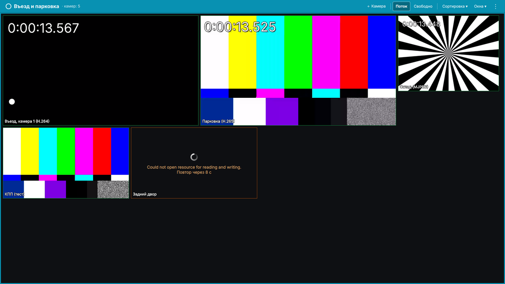

# CAMAI VMS — рабочее место администратора видеонаблюдения

Нативное приложение для одноплатника **Radxa ROCK 5T (Rockchip RK3588)** под **Armbian**:
несколько окон на нескольких мониторах, в каждом окне — любое количество плееров
сетевых видеопотоков **RTSP** с кодеками **H.264, H.265 (HEVC) и MJPEG**
и аппаратным декодированием.



## Возможности

- **Несколько окон** в одном процессе: каждое окно размещается на своём мониторе
  (меню «Окна → Переместить на экран», полноэкранный режим `F11`).
  Повторный запуск `hmi-vms` открывает ещё одно окно в уже работающем приложении.
- **Название, цвет и обои окна** — клик по цветному кружку слева на панели окна.
  Цветом выделяются панель и рамка окна. Обои — 6 встроенных в стилистике CAMAI (тёмные,
  неяркие) или любое изображение с компьютера; регулируемое затемнение, чтобы обои не
  отвлекали от видео.
- **Плееры**: RTSP, HLS, DASH, MSS, MPEG-TS по HTTP, MJPEG по HTTP, JPEG-снимки,
  MSE-LD (WebSocket), адреса Flussonic `m4s://`/`m4f://`, локальные файлы и тестовый сигнал
  (см. «Поддерживаемые источники»). Логин/пароль, транспорт RTSP (авто/TCP/UDP),
  размер буфера, выбор декодера (авто/аппаратный/программный), режим минимальной задержки.
- **Размер плеера** меняется с сохранением соотношения сторон потока: угол «◢» внизу справа,
  `Ctrl + колесо мыши`, пункты контекстного меню. Кнопка **«1:1»** — оригинальный (нативный)
  размер видео. Двойной клик — развернуть плеер на всё окно (`Esc` — вернуть).
- **Три раскладки** (переключатель на панели окна):
  - **«Поток»** — плееры идут по порядку с переносом строк;
  - **«Свободно»** — плееры размещаются в любом месте окна (перетаскивание за верхнюю панель плеера);
  - **«Сетка N×M»** — сетка из N строк и M столбцов (готовые варианты 1×1…8×8 или любые до
    16×16) занимает всё окно и масштабируется вместе с ним; видео вписывается в ячейку с
    сохранением пропорций. Плеер можно **растянуть на несколько ячеек** (любой прямоугольник:
    2×1, 2×2, 3×2…) за угол ◢ — рамка показывает размер с привязкой к ячейкам, остальные плееры
    плотно перестраиваются вокруг него. Если плееры не помещаются в N×M, сетка сама добавляет
    строки или столбцы (на кнопке видно «3×3 → 3×4»), всё остаётся видно без прокрутки.
    Перетаскивание плеера на место другого ставит его туда, остальные сдвигаются (в сетке 3×3
    плеер 2 на место 7: 1,3,4 / 5,6,7 / 2,8,9). Свободные ячейки отмечены «＋» (двойной клик —
    добавить камеру).
- **Поворот и отражение** каждого плеера (0/90/180/270°, по горизонтали/вертикали) —
  контекстное меню или настройки плеера; сохраняются. Выполняются на GPU без затрат CPU.
- **Индикатор состояния потока («светофор»)** поверх каждого плеера:
  🟢 норма, 🟡 есть проблемы, 🔴 видео нет или им нельзя пользоваться. Показывает «показано/номинал
  к/с»; подсказка при наведении называет причину и где узкое место: камера/сеть
  (мало кадров приходит), декодер (не успевает), отображение/GPU (окно перерисовывается реже,
  чем приходят кадры), перебои, недавнее переподключение.
- **Веб-интерфейс камеры** — в настройках плеера задаётся IP/URL страницы настроек камеры;
  пункт «Веб-интерфейс камеры…» контекстного меню открывает её в браузере. Если адрес не задан,
  пункт неактивен.
- **Сортировка**:
  - **вручную** — перетащите плеер за верхнюю панель на новое место (видна метка вставки),
    либо «Переместить в начало/в конец» в контекстном меню;
  - **автоматически** — по имени (естественный порядок «Камера 2» < «Камера 10»), адресу,
    размеру плеера, разрешению видео, состоянию, времени добавления;
    опция «Поддерживать сортировку автоматически» держит порядок при изменениях;
  - «Уместить все в окне (сетка)» (`Ctrl+G`) — одинаковые плееры максимального размера без прокрутки.
- **Надёжность**: автоматическое переподключение с нарастающей паузой (1→30 с), сторожевой
  таймер «нет кадров», автоматический переход на программный декодер при сбое аппаратного,
  «режим совместимости» для нестандартных форматов (например, HEVC 4:4:4).
- **Автовыбор качества потока.** Если у камеры несколько потоков (CAMAI — из каталога
  устройства, ONVIF — профили камеры, Flussonic — дорожки транскодера, либо список вручную),
  плеер берёт самый лёгкий поток, которого достаточно для его размера на экране (с учётом
  масштаба монитора и поворота), и переоценивает выбор при любом изменении размера: больше —
  сразу, меньше — если плеер остаётся маленьким 5 с. Потоки ниже минимальной частоты кадров
  (по умолчанию 10 к/с) берутся, только если других нет. Неизвестные параметры потоков
  определяются автоматически.
- **Переключение без чёрного экрана.** Новый поток готовится на второй (скрытой) поверхности,
  пока старый показывается; картинка меняется на первом кадре нового. При переподключении
  на экране остаётся последний кадр. Если новый кадр не пришёл за время «Ожидание видеопотока»
  (настройка программы, по умолчанию 3 с), поверх плеера выводится состояние обмена с камерой
  (подключение, ответ сервера, получено N КБ, ошибка и повтор); текст уменьшается, чтобы
  поместиться в плеер любого размера.
- **CAMAI**: в диалоге добавления — источник «Устройство CAMAI»: адрес сервиса
  (`192.168.53.168` или `http://…:8080`), «Получить каналы», отметить нужные — для каждого
  добавится плеер. Профили берутся из `/api/v1/preview` (повторно — при RTSP 404), состояние
  входа — из `/api/v1/status`: при отсутствии сигнала на плеере появляется плашка
  «Нет сигнала на входе камеры — сервер показывает заставку».
- **Звук**: если в потоке (или в другом потоке этой камеры) есть звук, в правом нижнем углу
  плеера виден динамик — перечёркнутый (звук выключен, по умолчанию) или с волнами (играет).
  Звук может играть только у одного плеера: включение у другого выключает предыдущий.
  Устройство вывода — в «Настройках программы» (по умолчанию системное).
- **Экономия ресурсов**: потоки плееров, которых не видно, останавливаются и автоматически
  возобновляются, когда плеер снова виден: в свободной раскладке — полностью закрытые другими
  плеерами, при прокрутке — ушедшие за край окна, за развёрнутым на всё окно плеером, в свёрнутых
  окнах, в окнах, которые композитор не выводит, и на **выключенных дисплеях** (состояние разъёма
  DRM: отключён, DPMS off; окно на другом, включённом дисплее продолжает работать). Плеер со
  включённым звуком не останавливается.
- Вся раскладка (окна, мониторы, геометрия, плееры) сохраняется автоматически.

## Поддерживаемые источники

Тип источника определяется по адресу; кодеки — H.264, H.265, MJPEG, декодер всегда выбирается
приложением (сначала аппаратный). Примеры адресов — для Flussonic Media Server (поток `cam1`):

| Источник | Пример адреса | Задержка | Примечание |
|---|---|---|---|
| RTSP | `rtsp://192.168.1.64:554/Streaming/Channels/101` | минимальная | UDP/TCP, логин/пароль |
| MSE-LD (WebSocket) | `ws://192.168.66.165/cam1/mse_ld` | минимальная | фрагменты fMP4; `wss://` для TLS |
| M4S (Flussonic) | `m4s://192.168.66.165/cam1` | минимальная | автоматически воспроизводится как MSE-LD (`ws://…/cam1/mse_ld`) |
| MPEG-TS по HTTP | `http://192.168.66.165/cam1/mpegts` | низкая | |
| M4F (Flussonic) | `m4f://192.168.66.165/cam1` | низкая | автоматически воспроизводится как MPEG-TS (`http://…/cam1/mpegts`) |
| MJPEG по HTTP | `http://camera/video.mjpg` | низкая | multipart/x-mixed-replace; при нехватке ресурсов старые кадры отбрасываются |
| HLS | `http://192.168.66.165/cam1/index.m3u8` (или `video.m3u8`) | 2–6 с | |
| DASH | `http://192.168.66.165/cam1/index.mpd` | 2–6 с | |
| MSS | `http://192.168.66.165/cam1.isml/manifest` | 2–6 с | Microsoft Smooth Streaming |
| JPEG-снимки | `http://192.168.66.165/cam1/preview.jpg` | интервал опроса | периодический опрос, интервал задаётся в настройках плеера (по умолчанию 1 с) |
| Файл / тест | `file:///home/user/video.mp4`, `test://ball` | — | |

M4F и M4S — внутренние протоколы Flussonic для обмена между серверами (требуют `cluster_key`,
формат не опубликован), поэтому плеер берёт тот же поток с эквивалентного публичного выхода
того же сервера: M4S → MSE-LD, M4F → MPEG-TS. Эти выходы должны быть включены в настройках потока.

Не являются видеопотоками и не поддерживаются как источник: **EMBED** (`embed.html` — веб-страница
с плеером), **API** (`media_info.json`, `recording_status.json`), **SHOUTCAST** (только аудио).

Для HLS/DASH/MSS кадры всегда синхронизируются по часам и не отбрасываются: сегмент
(обычно 2–6 с видео) декодируется быстрее реального времени и затем показывается в своём темпе.
Задержка таких протоколов — длина 1–3 сегментов. **Для наблюдения в реальном времени
используйте выходы MPEG-TS (`…/mpegts`), MSE-LD (`ws://…/mse_ld`) или RTSP** — у Flussonic они
доступны для того же потока.

## Выбранный стек и почему он самый быстрый на RK3588

| Слой | Технология | Зачем |
|---|---|---|
| Язык ядра | **C++17** | нет сборщика мусора и интерпретатора, предсказуемые задержки, `-mcpu=cortex-a76.cortex-a55` + LTO |
| UI | **Qt 6 Quick (QML)**, стиль Fusion | вся сцена рисуется на GPU Mali-G610 (OpenGL ES), отдельный поток рендеринга на окно |
| Видео | **GStreamer 1.20+** | готовые RTSP/RTP-депакетизаторы, джиттер-буфер, демультиплексоры HLS/DASH/MSS/TS/MP4, плагины аппаратных декодеров |
| Сеть | **Qt Network, Qt WebSockets** | опрос JPEG-снимков, MSE-LD по WebSocket (данные подаются в GStreamer через `appsrc`) |
| Декодирование | **Rockchip MPP** (`mppvideodec`, `mppjpegdec`) на vendor-ядре, **V4L2 stateless** (`v4l2slh264dec`, `v4l2slh265dec`) на mainline-ядре, программный `avdec_*` как резерв | видеопроцессор RK3588 декодирует до 32 потоков 1080p@30 при почти нулевой загрузке CPU |
| Вывод | **`glupload ! glcolorconvert ! qml6glsink`** | кадр из VPU (DMA-BUF) импортируется в текстуру GPU **без копирования**, YUV→RGB — один проход шейдера |
| Резервный вывод | `appsink → QVideoSink/VideoOutput` | если `qml6glsink` не установлен (`--render qt`) |

Ключевые решения для производительности:

- **Один процесс на все окна** — общий GStreamer, общий пул потоков, нет дублирования библиотек в ОЗУ.
- **Ноль копий кадра**: декодер → DMA-BUF → EGLImage → текстура; CPU не трогает пиксели.
- **Очередь на 2 кадра с вытеснением старых** перед выводом: при перегрузке кадры
  отбрасываются, а не накапливают задержку.
- **Остановка конвейеров в пуле потоков**: зависший сетевой teardown RTSP не блокирует интерфейс.
- **Делегаты QML не пересоздаются** при сортировке — меняются только координаты,
  видеоповерхности и декодеры продолжают работать без переподключения.
- Только видеодорожка RTSP (аудио/метаданные не запрашиваются у камеры — `select-stream`).

## Установка на Armbian (ROCK 5T)

### 1. Зависимости

```bash
git clone https://github.com/liharev/HMI.git
cd HMI
./scripts/install-deps.sh
```

### 2. Аппаратное декодирование

Проверьте, какие декодеры видит GStreamer:

```bash
gst-inspect-1.0 | grep -Ei "mpp|v4l2sl"
```

- **Vendor-ядро (6.1 BSP, `rk35xx` vendor)** — нужен плагин Rockchip MPP.
  На Armbian на базе Ubuntu 22.04/24.04:

  ```bash
  ./scripts/install-deps.sh --rockchip
  ```

  Если готовых пакетов для вашего дистрибутива нет (например, Ubuntu 26.04 / Debian),
  соберите MPP, librga и плагин GStreamer из исходников одной командой:

  ```bash
  ./scripts/build-rockchip-mpp.sh
  ```

  Вручную: соберите
  [gstreamer-rockchip](https://github.com/JeffyCN/rockchip_mirrors/tree/gstreamer-rockchip)
  и [mpp](https://github.com/rockchip-linux/mpp) из исходников. Признак успеха — `mppvideodec` в списке.
- **Mainline/edge-ядро (6.12+)** — декодеры V4L2 stateless из `gstreamer1.0-plugins-bad`
  (`v4l2slh264dec`; HEVC через rkvdec2 — в свежих ядрах). Пакет уже ставится скриптом.

Пользователь должен входить в группы `video` и `render` (скрипт добавляет; нужен перелогин).

> Также проверьте, что GUI работает на GPU, а не на программном рендере:
> `eglinfo -B | grep -i renderer` (или `glxinfo -B`) должно показывать `Mali-G610`
> (Panfrost/Panthor или libmali), а не `llvmpipe`.

### 3. Сборка

```bash
cmake -S . -B build -G Ninja -DCMAKE_BUILD_TYPE=Release
cmake --build build
sudo cmake --install build      # /usr/local/bin/hmi-vms + ярлык в меню
```

Опции CMake: `-DHMI_CPU_TUNING=ON` (оптимизация под Cortex-A76/A55, по умолчанию вкл.),
`-DHMI_LTO=ON` (LTO, по умолчанию вкл.).

### 4. Запуск

```bash
hmi-vms                 # первое окно (или восстановление сохранённой раскладки)
hmi-vms                 # повторный запуск — новое окно в работающем приложении
```

Параметры:

| Параметр | Описание |
|---|---|
| `-r, --render auto\|gl\|qt` | вывод видео: `gl` — qml6glsink (zero-copy), `qt` — Qt Multimedia; `auto` — gl, если доступен. То же: `HMI_RENDER=qt` |
| `-c, --config <файл>` | другой файл раскладки (запускается отдельный экземпляр) |
| `--separate` | не передавать запуск уже работающему экземпляру |
| `--font-scale <k>` | дополнительный масштаб шрифта интерфейса, например `1.25` (также `HMI_FONT_SCALE`) |

Автозапуск при входе в систему:

```bash
mkdir -p ~/.config/autostart && cp packaging/hmi-vms.desktop ~/.config/autostart/
```

## Работа с программой

| Действие | Как |
|---|---|
| Добавить плеер | «＋ Камера», `Insert` или `Ctrl+I` |
| Настройки плеера | ⚙ на панели плеера (появляется при наведении) или правый клик → «Настройки…» |
| Изменить размер | потянуть угол ◢; `Ctrl + колесо`; «Увеличить/Уменьшить» в меню |
| Оригинальный размер | «1:1» на панели плеера; для всех — «Сортировка → Оригинальный размер для всех» |
| Развернуть плеер | двойной клик по видео; `Esc` — вернуть |
| Сетка N×M | кнопка «Сетка N×M ▾» на панели окна |
| Плеер на несколько ячеек | в сетке потянуть угол ◢; вернуть — правый клик → «Одна ячейка сетки» |
| Камеры CAMAI | «＋ Камера» → вкладка «Устройство CAMAI» → «Получить каналы» |
| Потоки камеры (качество) | настройки плеера → «Качество: потоки камеры»: ONVIF, Flussonic, «Добавить поток», «Определить параметры» |
| Звук | значок динамика в правом нижнем углу плеера |
| Настройки программы | ⋮ → «Настройки программы…» (ожидание потока, автовыбор качества, устройство звука) |
| Поворот / отражение | правый клик по плееру → «Поворот и отражение» или настройки плеера |
| Веб-интерфейс камеры | правый клик по плееру → «Веб-интерфейс камеры…» (адрес задаётся в настройках плеера) |
| Обои | клик по цветному кружку слева на панели окна → «Обои» |
| Ручная сортировка | перетащить плеер за верхнюю панель |
| Автосортировка | меню «Сортировка» |
| Уместить все | `Ctrl+G` |
| Новое окно | `Ctrl+N`, «Окна → Новое окно» или повторный запуск `hmi-vms` |
| Окно на другой монитор | «Окна → Переместить на экран»; `F11` — во весь экран |
| Название и цвет окна | клик по цветному кружку слева на панели окна |
| Закрыть окно | крестик окна; вернуть — «Окна → <имя окна>» |
| Удалить окно | «Окна → Удалить окно…» |
| Выход | `Ctrl+Q` (закрытие последнего окна тоже завершает программу) |

Цвет рамки плеера: зелёный — воспроизведение, жёлтый — подключение,
оранжевый — переподключение (с причиной ошибки), серый — остановлен/приостановлен.
На панели плеера показаны кодек, разрешение, к/с и декодер (`HW` — аппаратный, `SW` — программный).

> **Wayland**: композитор не позволяет приложению самому задавать позицию окна,
> поэтому при старте окна открываются на сохранённом мониторе в полноэкранном режиме
> (если были в нём), а оконные — там, где их разместит композитор.
> На X11 позиция и размер восстанавливаются точно.

### Рекомендации по производительности

- Укажите плееру **все потоки камеры** (ONVIF находит их сам; substream вроде
  `.../Channels/102` у Hikvision или `subtype=1` у Dahua) — плеер сам возьмёт лёгкий поток для
  маленькой плитки и подробный для большой: декодировать 4K ради плитки 400×225 бессмысленно.
- Транспорт **TCP** надёжнее через NAT/VPN/Wi-Fi; **UDP** даёт минимальную задержку в локальной сети.
- «Минимальная задержка» выводит кадр сразу после декодирования (без синхронизации по часам).
- Буфер 100–300 мс — разумный компромисс; при потерях пакетов увеличьте.

## Конфигурация

Раскладка хранится в `~/.config/hmi/hmi-vms/layout.json` (права `0600`, так как содержит
пароли камер) и сохраняется автоматически через 1,5 с после любого изменения.

## Проверка без камер

В комплекте тестовый RTSP-сервер (H.264, H.265, MJPEG, 4K):

```bash
sudo apt install python3-gi gir1.2-gst-rtsp-server-1.0 gstreamer1.0-plugins-ugly
./tools/test-rtsp-server.py
```

Адреса: `rtsp://127.0.0.1:8554/h264`, `/h265`, `/mjpeg`, `/h264-4k`.
Без сервера можно добавить плеер `test://ball` или `test://smpte?w=1920&h=1080&fps=30`.

Макет устройства CAMAI (REST `/api/v1/preview`, `/api/v1/status` и RTSP `/<канал>/<поток>`:
основные потоки 1080p и 360p со звуком AAC, превью 360p@5, 480p@10, 720p@15 без звука):

```bash
sudo apt install gstreamer1.0-libav
./tools/camai-mock.py --no-signal 1 --fail-503 0/3   # канал 1 без сигнала, 0/3 отвечает 503
```

Макет ONVIF-камеры (логин `admin`, пароль `12345`, часы камеры спешат на 2 минуты, во внутренних
адресах — 10.0.0.5, как у камер за NAT) и `media_info.json` Flussonic (`/cam1/…`):
`./tools/onvif-mock.py` (потоки берёт у макета CAMAI).

Переменные для разработчика: `HMI_DEBUG_STATS=1` — статистика плееров раз в секунду;
`HMI_TEST_SWITCH="url1;url2"` (+ `HMI_TEST_SWITCH_SEC`) — циклическое переключение потоков;
`HMI_TEST_DRM_ROOT` — подмена `/sys/class/drm` (проверка выключенного дисплея);
`HMI_AUDIO_SINK=fakesink` — вывод звука без звуковой карты.

## Диагностика

**Кнопка «Диагностика»** на панели каждого окна (и пункт меню `⋮ → Диагностика…`) показывает
общее состояние цветом: 🟢 всё в порядке, 🟡 есть замечания, 🔴 серьёзные проблемы (мигает).
Окно диагностики обновляется каждые 2 с и показывает по разделам, с инфографикой и
рекомендациями по устранению:

| Раздел | Что показывает |
|---|---|
| Видеопотоки | сколько плееров в норме / с замечаниями / с проблемами, показано кадров от номинала, входящий трафик, список проблемных камер с причиной |
| Процессор | общая загрузка и по ядрам, частоты, средняя нагрузка; перегрузка, «одно ядро на 100%», троттлинг |
| Температура | все датчики SoC; предупреждение до наступления троттлинга (≈85 °C) |
| Оперативная память | ОЗУ, CMA-память для видеобуферов декодера, подкачка, сколько занимает программа |
| Сеть | скорость подключения, фактический приём, сколько нужно потокам, ошибки; распознаёт подключение на 100 Мбит/с |
| Видеодекодер | MPP / V4L2 / только программный, сколько потоков на аппаратном декодере и на CPU, распределение, H.265 без аппаратной поддержки |
| Графика | видеочип и загрузка GPU, частота перерисовки окон, способ вывода потоков, работа без аппаратного ускорения |

Кнопка **«Скопировать отчёт»** кладёт полный текстовый отчёт в буфер обмена — его удобно
отправить в поддержку.

### Видео «дёргается», кадры меняются раз в несколько секунд

Наведите курсор на индикатор состояния плеера — подсказка покажет частоты кадров:
**приём** (от камеры) → **декодирование** → **показ** → **перерисовка окна**.

- **Перерисовка окна ≪ показ** («Отображение не успевает … перегружен GPU/вывод») — интерфейс
  рисуется без аппаратного ускорения или GPU перегружен. Откройте «⋮ → О программе», строка
  «Графика (GPU)»: должно быть `Mali-G610` (Panfrost/Panthor или libmali). Если там `llvmpipe` —
  драйвер GPU не работает (программа также показывает красное предупреждение сверху окна).
  На Armbian: для vendor-ядра установите libmali/panthor из пакетов Armbian или
  `mesa` ≥ 24.1 с драйвером Panthor; проверка — `eglinfo -B | grep -i renderer`.
- **Декодирование ≪ приём** («Декодер не успевает») — работает программный декодер:
  установите плагин MPP (раздел «Аппаратное декодирование»), для мелких плееров используйте
  дополнительный поток камеры.
- **Приём ≪ номинал** («Источник присылает мало кадров») — проблема на стороне камеры/сети:
  попробуйте транспорт TCP, проверьте битрейт и загрузку сети.

- **Показ ≪ декодирование** при нормальной перерисовке окна — медленная загрузка кадров
  декодера в GPU / медленное чтение памяти аппаратного декодера (наблюдается с
  `v4l2slh264dec` на mainline-ядрах RK3588). При декодере «Авто» плеер сначала переходит на
  программный декодер (кадры в обычной кэшируемой памяти), затем при необходимости (вывод
  «Авто») — GPU с копированием кадра → Qt Multimedia, и запоминает подошедший вариант
  (в настройках плеера: «Декодер», «Вывод видео»; выбор «Авто» заново запускает подбор). Принудительно для всех:
  `HMI_GL_COPY=1 hmi-vms` (копирование) или `hmi-vms --render qt` (Qt Multimedia).

Подробная статистика по секундам в терминал: `HMI_DEBUG_STATS=1 hmi-vms` — частоты
«in» (приём), «dec» (декодирование), «upload» (загрузка в GPU), «shown» (до вывода),
«render» (перерисовка окна), текущий способ вывода и формат кадров декодера.

Сообщение `qt.qpa.services: Failed to register with host portal … App info not found` безвредно
(ярлык не установлен); после `sudo cmake --install build` оно не появляется.

### Много потоков: кадров в секунду становится меньше у всех

Аппаратный декодер один на все потоки. С драйвером обычного (mainline) ядра
(`v4l2slh264dec`) на RK3588 он выдаёт порядка 60 кадров 1080p в секунду в сумме
(≈ 4 потока 1080p@16). Когда он перегружен, программа автоматически переводит часть
плееров с декодером «Авто» на процессор и возвращает их, когда появляется резерв.
Текущее распределение — «⋮ → О программе → Декодирование». Полную мощность видеоблока
RK3588 (до 32 потоков 1080p@30, H.264 и H.265) даёт vendor-ядро Rockchip с MPP
(`mppvideodec`, см. «Аппаратное декодирование»). Для сеток из многих камер используйте
дополнительные потоки камер с меньшим разрешением.

### Прочее

- «О программе» (меню `⋮`) показывает способ вывода видео, видеочип (GPU) и найденные аппаратные декодеры.
- Подробный лог GStreamer: `GST_DEBUG=2 hmi-vms`, для RTSP: `GST_DEBUG=rtspsrc:5`.
- Если плеер постоянно уходит в «режим совместимости» или «переход на программный декодер» —
  проверьте установку плагина MPP и права на `/dev/mpp_service`, `/dev/rga`.
- Проблемы с GL-выводом: запустите с `--render qt`.

## Структура проекта

```
src/main.cpp           запуск, выбор способа вывода, единственный экземпляр (QLocalServer)
src/appcontroller.*    окна, мониторы, сохранение раскладки
src/vmswindow.*        окно: название, цвет, раскладки «поток»/«свободно», сортировка
src/player.*           плеер: конвейеры GStreamer для всех источников, MSE-LD, JPEG-снимки,
                       переподключение, бесшовное переключение (две поверхности), автовыбор
                       потока, остановка невидимых плееров, звук, статистика
src/streamprofile.*    потоки камеры (профили), выбор по размеру плеера, определение параметров
src/camai.*            устройства CAMAI: каталог /api/v1/preview, состояние /api/v1/status
src/discovery.*        ONVIF (GetProfiles/GetStreamUri) и Flussonic (media_info.json)
src/diagnostics.*      окно «Диагностика»
src/gstutils.*         выбор аппаратного/программного декодера
qml/MonitorWindow.qml  окно (панель, меню, область плееров)
qml/PlayerTile.qml     плеер (видео, панель управления, перетаскивание, изменение размера)
qml/*Dialog.qml        диалоги плеера, окна (цвет, обои), подтверждения
resources/wallpapers/  встроенные обои CAMAI (генерируются tools/make-wallpapers.py)
tools/test-rtsp-server.py  тестовый RTSP-сервер
tools/camai-mock.py        макет устройства CAMAI (REST + RTSP, звук, 503, нет сигнала)
tools/onvif-mock.py        макет ONVIF-камеры и media_info.json Flussonic
tools/make-wallpapers.py   генератор обоев (Pillow + NumPy)
scripts/install-deps.sh    установка зависимостей
```

Требования: Qt ≥ 6.4 (+ Qt WebSockets для MSE-LD), GStreamer ≥ 1.20 (для HLS/DASH/MSS рекомендуется ≥ 1.22), CMake ≥ 3.16, компилятор C++17.
